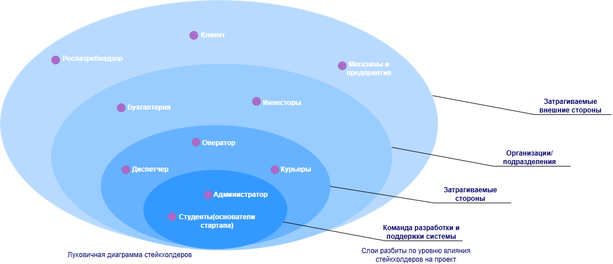

### Анализ стейкхолдеров, выявление потребностей и глоссарий проекта

Кейс по бизнес-анализу: исследование заинтересованных сторон продукта, структурирование их проблем, интересов и формирование единого глоссария терминов для команды.

---

### Что сделано в рамках проекта

* **Карта и реестр стейкхолдеров (`ex00_dlv_stakeholders.xlsx`):** выявлены все ключевые заинтересованные стороны, определены их роли и степень влияния на проект.
* **Луковичная диаграмма (`ex01_dlv_onion.png`):** визуализированы уровни взаимодействия стейкхолдеров с системой (от ядра команды до внешнего окружения).
* **Анализ потребностей и проблем (`ex02_dlv_needs.xlsx`):** зафиксированы боли, интересы и ожидания каждой группы пользователей для последующей приоритизации требований.
* **Проектные глоссарии (`ex03_dlv_glossary.xlsx`):** систематизирована предметная терминология для устранения разночтений между бизнесом и разработкой.

---

### Визуализация: Луковичная диаграмма стейкхолдеров

---

### Использованные инструменты и навыки
* **Бизнес-анализ:** выявление стейкхолдеров, сбор и анализ потребностей (Needs & Problems), составление глоссария.
* **Инструменты:** Excel (структурирование табличных данных), draw.io (визуализация схем).
