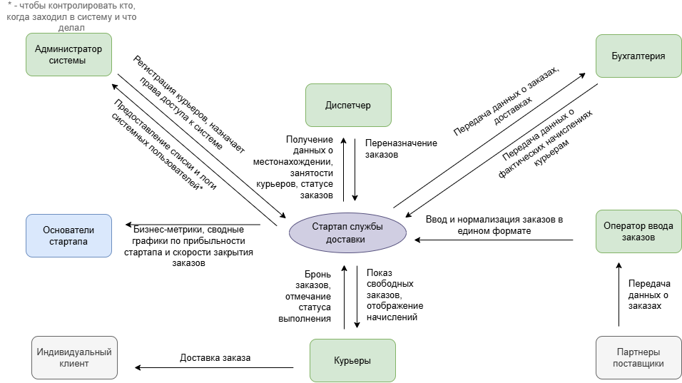

### Анализ процессов (As-Is / To-Be), контекстная диаграмма и потоки данных

Кейс по бизнес- и системному анализу: моделирование текущего состояния бизнес-процессов, проектирование целевого решения, определение границ системы и описание информационных потоков.

---

### Что сделано в рамках проекта

* **Анализ текущего состояния (`ex00_dlv_asis.xlsx`, `ex00_sal_asis.xlsx`):** зафиксированы текущие бизнес-процессы (As-Is), выявлены узкие места и точки потерь.
* **Актуализация стейкхолдеров (`ex00_dlv_stakeholders.xlsx`, `ex00_sal_stakeholders.xlsx`):** уточнен реестр заинтересованных сторон с учетом детальных требований.
* **Контекстная диаграмма (`ex01_dlv_context.png`):** определены границы проектируемой системы и ее взаимодействие с внешними сущностями.
* **Проектирование целевого решения (`ex02_dlv_tobe.xlsx`, `ex02_sal_tobe.xlsx`):** сформирована модель процесса «как должно быть» (To-Be) для устранения выявленных проблем.
* **Анализ потоков данных (`ex03_dlv_streams.xlsx`, `ex03_sal_streams.xlsx`):** систематизированы входные и выходные информационные потоки системы.
* **Актуализация глоссария (`ex04_dlv_glossary.xlsx`, `ex04_sal_glossary.xlsx`):** дополнен словарь предметной области новыми терминами.

---

### Визуализация: Контекстная диаграмма системы

---

### Использованные инструменты и навыки
* **Бизнес-анализ:** моделирование процессов (As-Is / To-Be), проектирование контекстных диаграмм, анализ потоков данных (Data Streams), управление требованиями.
* **Инструменты:** Excel, нотации визуального моделирования.
